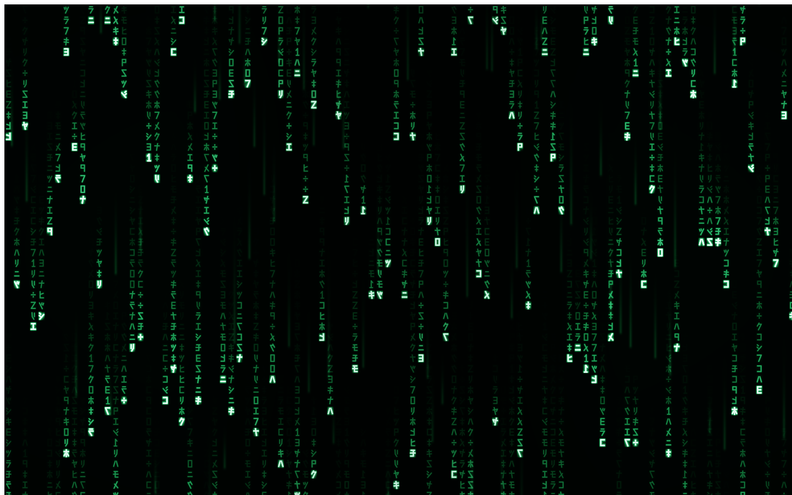
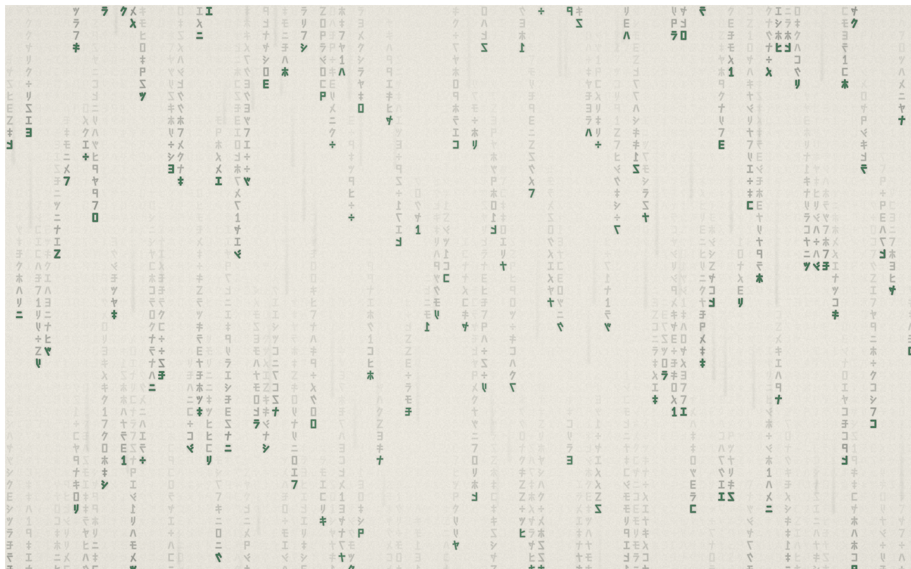
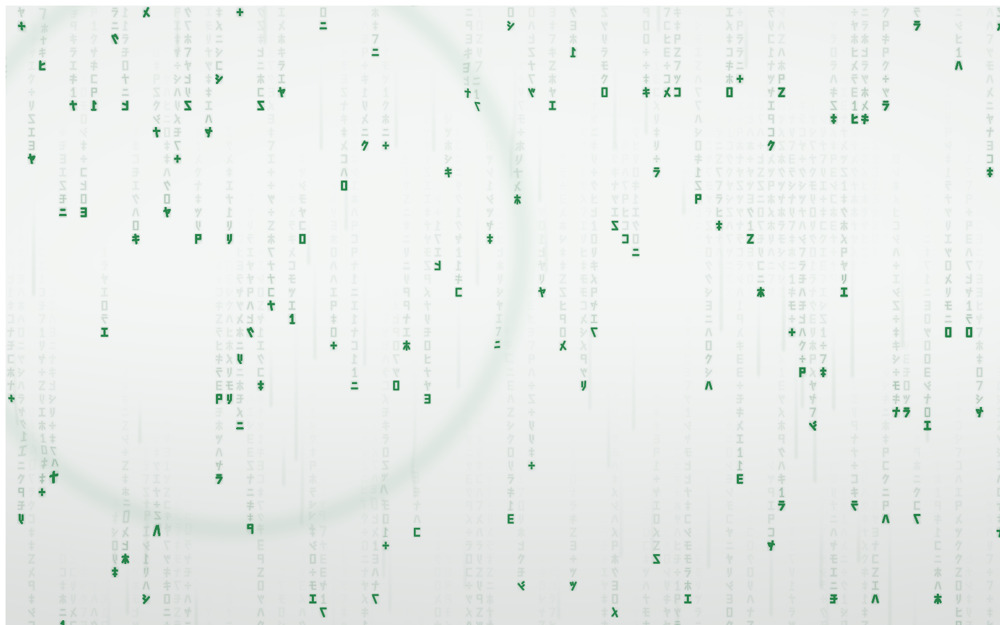
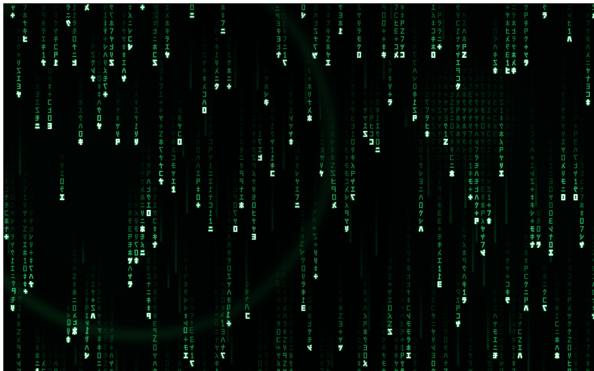

# Digital Rain

A theme for the Claude desktop app: falling columns of glowing glyphs behind your conversation, drawn live on your GPU. It has three looks:

- **Green rain** (the default): phosphor-green glyphs on black glass, each column led by a white-hot glyph.
- **White room**: a bright, empty white space where the same rain falls softly in grey-green.
- **Paper**: the rain as e-ink, soft charcoal on a warm grey page, with muted green leading glyphs and Claude's replies set in a bookish serif.



## Install

You need the **Claude desktop app**, which is where the theme shows. Pick whichever way is easier for you.

### The easy way: in the desktop app (no terminal)

1. Click **+** next to the prompt box.
2. Click **Plugins**.
3. Click **Add marketplace** and paste:

   ```
   dontcallmejames/claude-digital-rain
   ```

4. Click **Add plugin** next to **digital-rain**.

That's it. The rain starts falling behind your conversation.

### Or: one command in a terminal

If you have Claude Code installed, paste this into a terminal:

```bash
claude plugin install digital-rain --marketplace dontcallmejames/claude-digital-rain
```

If it asks whether to add the marketplace, type `y` and press Enter. Then open a session in the Claude desktop app.

Already inside a Claude Code session? Type this at its prompt instead:

```
/plugin install digital-rain --marketplace dontcallmejames/claude-digital-rain
```

## Using it

- **Switch looks** by typing one of these in a session. Your choice is remembered.

  | Type | To get |
  | --- | --- |
  | `/digital-rain dark` | the green rain (the default) |
  | `/digital-rain light` | the white room |
  | `/digital-rain paper` | the e-ink paper look |
  | `/digital-rain auto` | the green rain or the white room, matching your computer's light or dark setting |

- **Hover** over the background: the hidden glyphs between the drops light up around your pointer.
- **Click** the background: a ripple runs out through the rain, and a burst of fast drops falls from where you clicked.
- **Sound** is off until you turn it on. Press the speaker button in the session's title bar to hear a low machine-room hum and short digital cues.

## Remove it

```bash
claude plugin uninstall digital-rain
```

To switch it off without removing it, use `claude plugin disable digital-rain`, and `claude plugin enable digital-rain` to bring it back.

## More about it







*These previews are software renders of the shader's own math, not screenshots of the app.*

- **The rain**: one grid of glyph columns, each falling at its own speed, over a slow out-of-focus haze for depth. The glyphs stand still while the light runs down them; some are mirrored, and some change now and then. All 24 glyphs are original, drawn for this theme.
- **Messages**: Claude's replies are readout panels with glowing corner brackets; yours are input lines with a `>` caret; everything is in monospace. On paper, Claude's replies become paper cards in a serif.
- **Paper, up close**: a fine still grain in the page, ink that spreads a touch instead of glowing, and a faint ghost of every glyph, the way e-ink screens keep traces of old pages.
- **Easy on the eyes**: nothing flickers faster than about once a second, and the rain dims behind the text you're reading. With Reduce Motion on, or on a phone, you get a still frame of the rain instead.

### Inside

| File | What it holds |
| --- | --- |
| `hooks/register.tsx` | the hooks: sets the theme, draws the backdrop, answers `/digital-rain` |
| `hooks/rain.ts` | the GPU shader: rain, hover, ripple and bursts, in all three looks |
| `hooks/glyphs.ts` | the glyph designs, as strokes in a unit box |
| `hooks/scene.ts` | the still frames shown where the shader doesn't play |
| `hooks/look.ts` | colors, message styles and sounds for each look |
| `tests/` | checks for the colors, glyphs, scene and backdrop (`claude plugin test .`) |

`hooks/rain.ts` holds the glyph strokes as a literal table, since a shader can't import: change it together with `hooks/glyphs.ts`.

`hooks/make-colors.js` and `hooks/make-colors.d.ts` are Claude Code's own color helper for theme mods, which builds a full palette from a few colors. They are copied in unchanged, as Claude Code asks, and aren't part of this project's own code.

## License

MIT, for this project's own code. See `LICENSE`.
