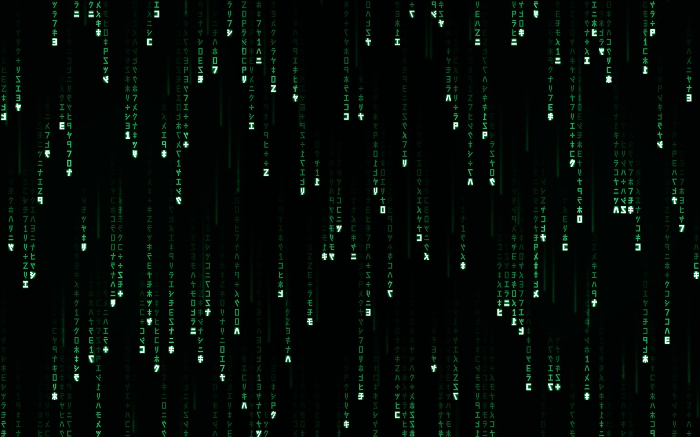
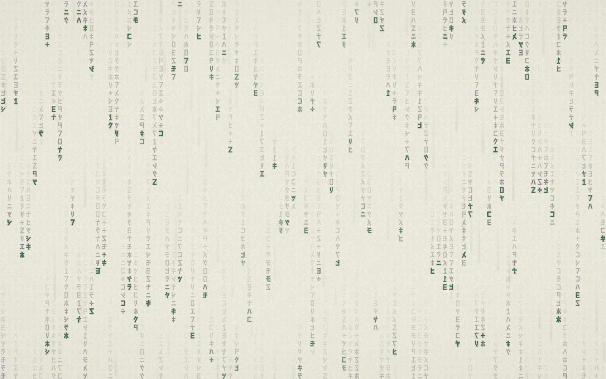
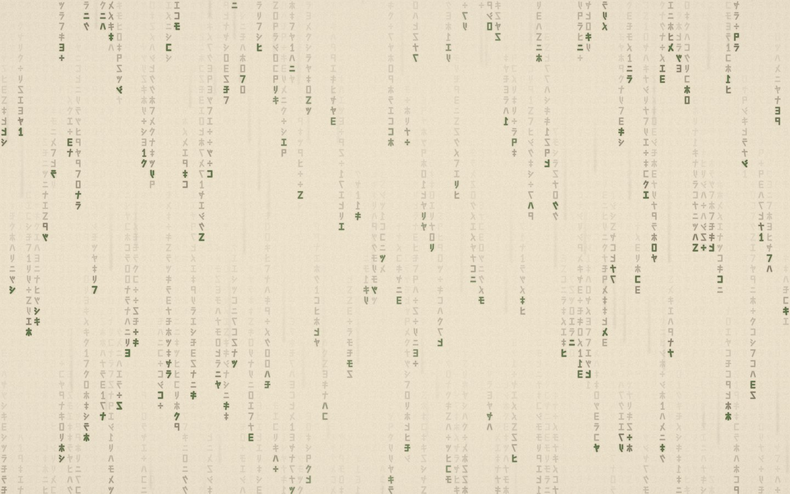
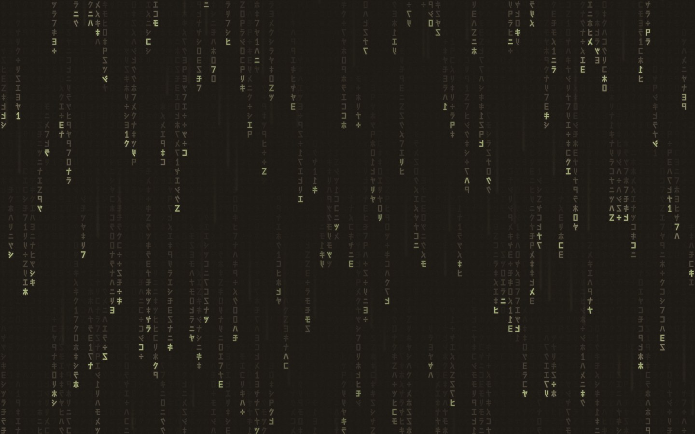
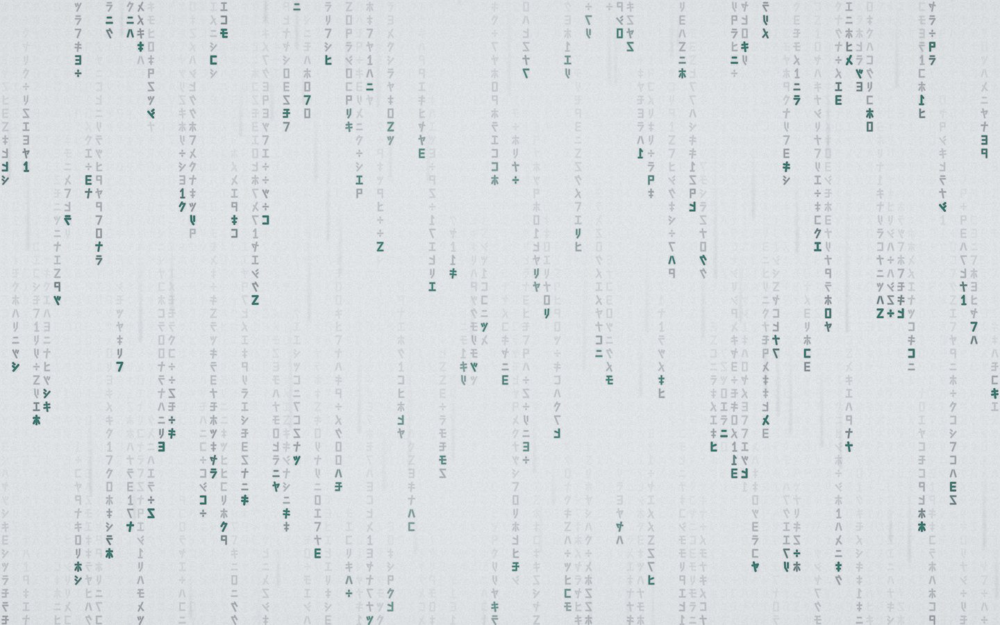
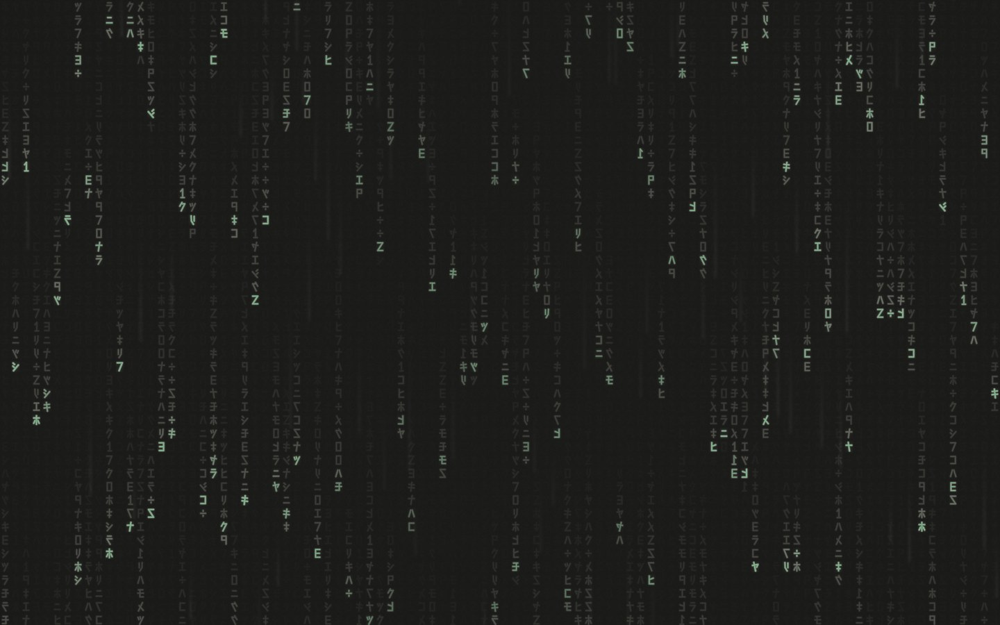
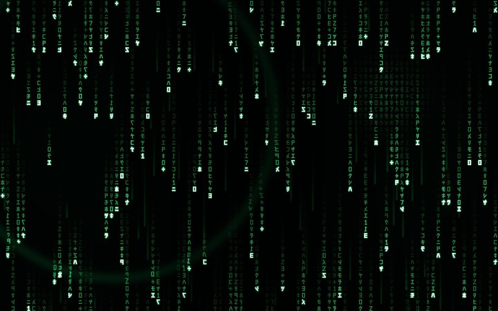

# Digital Rain

A theme for the Claude desktop app: falling columns of glyphs behind your conversation, drawn live on your GPU. It reacts to your pointer, restyles the chat, and comes in eight looks, from glowing green rain to soft e-ink paper.



## The looks

Switch any time by typing the command in a session. Your choice is remembered.

| | |
| --- | --- |
|  **Green rain**, the default<br>`/digital-rain dark`<br>Phosphor-green glyphs on black glass, each column led by a white-hot glyph. |  **The white room**<br>`/digital-rain light`<br>A bright, empty white space where the rain falls softly in grey-green. |
|  **Paper**<br>`/digital-rain paper`<br>The rain as e-ink: soft charcoal on a warm grey page, with muted green leading glyphs. |  **Night paper**<br>`/digital-rain night`<br>E-ink's dark mode: light grey ink on a charcoal page. Shown here in slate. |
|  **Sepia**<br>`/digital-rain sepia`<br>An old paperback: cream pages, brown-black ink, olive-green leading glyphs. |  **Sepia, at night**<br>`/digital-rain sepia`, then `/digital-rain night`<br>A brown-black page with cream ink. |
|  **Slate**<br>`/digital-rain slate`<br>A cool blue-grey screen with teal-green leading glyphs. |  **Warm grey, at night**<br>`/digital-rain paper`, then `/digital-rain night`<br>A neutral charcoal page with soft grey ink. |

Night paper keeps the tone you picked last. To follow your computer's light or dark setting automatically:

- `/digital-rain paper auto`: your paper tone by day, its night paper at night.
- `/digital-rain auto`: the green rain at night, the white room by day.

Type `/digital-rain` on its own to see which look is showing and every option.

*The pictures are software renders of the theme's own shader math, not screenshots of the app.*

## Install

You need the **Claude desktop app**, which is where the theme shows. Pick whichever way is easier for you.

### The easy way: in the desktop app (no terminal)

1. Click **+** next to the prompt box.
2. Click **Plugins**.
3. Click **Add marketplace** and paste:

   ```
   dontcallmejames/claude-digital-rain
   ```

4. Click **Add plugin** next to **digital-rain**.

That's it. The green rain starts falling behind your conversation. Pick another look with the commands above.

### Or: one command in a terminal

If you have Claude Code installed, paste this into a terminal:

```bash
claude plugin install digital-rain --marketplace dontcallmejames/claude-digital-rain
```

If it asks whether to add the marketplace, type `y` and press Enter. Then open a session in the Claude desktop app.

Already inside a Claude Code session? Type this at its prompt instead:

```
/plugin install digital-rain --marketplace dontcallmejames/claude-digital-rain
```

## Playing with it



- **Hover** over the background: the hidden glyphs between the drops come up around your pointer and fade back when you move on.
- **Click** the background: a ripple runs out through the rain, bending the columns as it passes, and a burst of fast drops falls from where you clicked.
- **Sound** is off until you turn it on. Press the speaker button in the session's title bar: a low machine-room hum and short digital cues with the green rain, a hush of room tone and soft rounded cues on paper.

## Remove it

```bash
claude plugin uninstall digital-rain
```

To switch it off without removing it, use `claude plugin disable digital-rain`, and `claude plugin enable digital-rain` to bring it back.

## More about it

- **The rain**: one grid of glyph columns, each falling at its own speed, over a slow out-of-focus haze for depth. The glyphs stand still while the light runs down them; some are mirrored, and some change now and then. All 24 glyphs are original, drawn for this theme.
- **Paper, up close**: a fine still grain in the page, ink that spreads a touch instead of glowing, a faint ghost of every glyph the way e-ink screens keep traces of old pages, and drops that glide smoothly from cell to cell.
- **Messages**: with the green rain and the white room, Claude's replies are readout panels with glowing corner brackets and yours are input lines with a `>` caret, all in monospace. On paper, Claude's replies become paper cards in a bookish serif.
- **Easy on the eyes**: nothing flickers faster than about once a second, and the rain dims behind the text you're reading. With Reduce Motion on, or on a phone, you get a still frame of the look instead.

### Inside

| File | What it holds |
| --- | --- |
| `hooks/register.tsx` | the hooks: sets the theme, draws the backdrop, answers `/digital-rain` |
| `hooks/rain.ts` | the GPU shader: rain, hover, ripple and bursts, in every look |
| `hooks/glyphs.ts` | the glyph designs, as strokes in a unit box |
| `hooks/scene.ts` | the still frames shown where the shader doesn't play |
| `hooks/look.ts` | colors, message styles and sounds for each look |
| `tests/` | checks for the colors, glyphs, scenes and backdrop (`claude plugin test .`) |

`hooks/rain.ts` holds the glyph strokes as a literal table, since a shader can't import: change it together with `hooks/glyphs.ts`.

`hooks/make-colors.js` and `hooks/make-colors.d.ts` are Claude Code's own color helper for theme mods, which builds a full palette from a few colors. They are copied in unchanged, as Claude Code asks, and aren't part of this project's own code.

## License

MIT, for this project's own code. See `LICENSE`.
